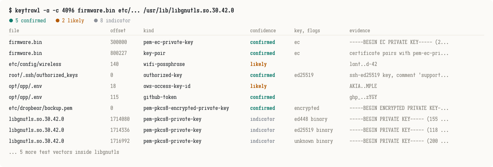

# keytrawl

<p>
  <picture>
    <source media="(prefers-color-scheme: dark)" srcset="docs/images/findings-dark.svg">
    
  </picture>
</p>

A secret finder for raw bytes, written in C. Firmware images, executables, memory dumps and disk
images go in, in pieces of any size; private keys, cloud tokens and configuration secrets come
out, each one checked before it is reported. Every pattern runs in a single Aho-Corasick pass, a
secret cut between two pieces is still found, and something that only looks like a secret is
reported as an indicator, not as a finding.

The picture above is the real output of [`examples/keytrawl.c`](examples/keytrawl.c), fed in
4 KiB pieces: a key and its certificate hidden in a firmware blob, router configuration, an
`.env` file, and the test vectors gnutls carries in its own library.

## Detectors

| Kind | How it is checked | Confidence |
|---|---|---|
| PEM private keys: RSA, EC, DSA, OpenSSH, PKCS#8, encrypted PKCS#8 | base64 decoded on the fly; the DER walked against its ASN.1 schema (RFC 8017, RFC 5915, RFC 5208, RFC 5958); OpenSSH `openssh-key-v1` framing | confirmed when the structure holds, indicator otherwise |
| Bare DER private keys: PKCS#1 RSA, DSA, SEC 1 EC, PKCS#8, PKCS#8 encrypted with PBES2 | same schemas, plus the key inside a PKCS#8 envelope and the relations of RSA parameters (odd modulus, primes of half its size) | confirmed |
| AWS access key ID `AKIA`/`ASIA` | prefix and alphabet ([IAM identifiers](https://docs.aws.amazon.com/IAM/latest/UserGuide/reference_identifiers.html)); marks a 40-character secret key in the 240 bytes after it (`KTW_CHECK_PAIRED`) | likely |
| GitHub tokens `ghp_` `gho_` `ghu_` `ghs_` `ghr_` | CRC32 of the token against its last 6 characters ([token formats](https://github.blog/2021-04-05-behind-githubs-new-authentication-token-formats/)); a failed checksum reports nothing | confirmed |
| GitHub `github_pat_` | length and alphabet of both parts | likely |
| Google API key `AIza` | length 39 and alphabet; no published specification | likely |
| Slack `xoxb-` `xoxp-` `xoxa-` `xoxr-` `xoxs-` | numeric segments and final part ([token types](https://api.slack.com/authentication/token-types)) | likely |
| Stripe `sk_live_` | length and alphabet ([API keys](https://docs.stripe.com/keys)) | likely |
| npm `npm_` | CRC32 of the token against its last 6 characters, as GitHub's ([token format](https://github.blog/changelog/2021-09-23-npm-has-a-new-access-token-format)); a failed checksum reports nothing | confirmed |
| PyPI `pypi-` | the fixed start of a macaroon for `pypi.org` and at least 85 base64url characters ([token scanning](https://warehouse.pypa.io/development/token-scanning.html)) | likely |
| GitLab `glpat-` | 20 characters of `[0-9A-Za-z_-]` ([token prefixes](https://docs.gitlab.com/security/tokens/)); the longer routable form has no published layout | likely, indicator when routable |
| Wi-Fi passphrase | in `/etc/config/wireless`, `hostapd*.conf`, `wpa_supplicant*.conf`: `option key`, `wpa_passphrase`, `psk` | likely |
| Raw Wi-Fi key | in the same files: 64 hex digits in `wpa_psk`, unquoted `psk` or `option key` | likely |
| `authorized_keys` line | key type, base64 and the SSH wire format of the public key | confirmed when valid, indicator otherwise |
| Key pairs: a public key whose private key is in the same stream | the public value (RSA n, DSA y, EC point, Ed25519 key) of PEM `PUBLIC KEY`, `RSA PUBLIC KEY`, `CERTIFICATE`, DER SubjectPublicKeyInfo and OpenSSH lines, equal to that of a private key; computed from PKCS#8 Ed25519 and DSA keys, which do not carry it | confirmed |
| Your own literals | your validator callback decides | yours |

Private keys and key pairs inside an executable are reported as indicators with
`KTW_FLAG_IN_BINARY`: those are almost always test vectors. A stream is an executable when it
starts with an ELF header, or when the caller says so with `KTW_STREAM_BINARY` (a PE inside a UEFI
volume, a kernel, a slice of a memory dump). Encrypted keys carry
`KTW_FLAG_ENCRYPTED`. keytrawl never decrypts anything and never touches the network.

A key pair is the sign of a factory key: every unit ships the same private key, and the public
half shows what it is used for. The finding points at the public key, and
`ktw_finding_pair_offset` at the private one. The scanner remembers the last 32 keys of a stream;
a pair farther apart than that is not seen. PKCS#8 Ed25519 and DSA keys have their public value
computed only when a public key of their algorithm is among those 32, at most 32 computations at
once and one more every 128 KB of stream, so a stream packed with keys cannot slow the scan. Encrypted PKCS#8 and legacy encrypted PEM keys cannot
be paired; encrypted OpenSSH keys can, since their public key is in clear.

The evidence never holds the secret: at most its first 4 and last 4 bytes (`AKIA…MPLE`).

## Feeding it

A catalog is built once and is read-only after `ktw_catalog_compile`; each stream or thread gets
its own scanner. The name passed to `ktw_scanner_reset` turns on the Wi-Fi and `authorized_keys`
rules, and `KTW_STREAM_BINARY` marks an executable the ELF check would not recognise. A callback
that returns nonzero stops the scan.

```c
static int print_finding(void *ctx, const ktw_finding_t *f)
{
    printf("%s at %llu: %s\n", ktw_finding_name(f), (unsigned long long)ktw_finding_offset(f),
           ktw_finding_evidence(f));
    return 0;
}

ktw_catalog_create(KTW_GROUP_ALL, NULL, NULL, NULL, &catalog);
ktw_catalog_compile(catalog);
ktw_scanner_create(catalog, NULL, NULL, NULL, &scanner);
ktw_scanner_reset(scanner, "/etc/config/wireless", 20, KTW_STREAM_AUTO);
while ((n = fread(buf, 1, sizeof buf, in)) > 0)
    ktw_feed(scanner, buf, n, print_finding, NULL);
ktw_finish(scanner, print_finding, NULL);
```

[`examples/basic.c`](examples/basic.c) is the shortest complete program. The API reference is
[`include/keytrawl/keytrawl.h`](include/keytrawl/keytrawl.h); in short:

- a function that can fail returns `KTW_OK` or a code `ktw_strerror` describes
- what `ktw_x_create` returns is released by `ktw_x_destroy`, which accepts `NULL`
- arguments are never owned by the library; pointers it returns belong to it
- the create functions take an allocator, or `NULL` for `malloc` and `free`
- `ktw_feed` and `ktw_finish` never allocate, and a scanner stays near 24 KB on any input

## Measured

Measured for 0.2.0 on 2026-04-17, AMD Ryzen 7 5700G, GCC 16.2, release build. Every number has
a script.

| Measure | Result | Script |
|---|---|---|
| One thread, random bytes | 1251 to 1341 MB/s | `bench/bench.c` |
| One thread, the shared libraries of `/usr/lib` concatenated (256 MB) | 1682 to 1883 MB/s | `bench/bench.c file` |
| Four threads, one catalog | 4.67x one thread on random bytes, 3.44x to 3.60x on the libraries | `bench/bench.c` |
| fwtriage's Python scan on the same bytes (measured for 0.1.0) | 33 to 53 MB/s; keytrawl is 11x to 21x faster | `bench/python_bench.py` |
| 1 GB of `-----BEGIN ` | linear (3.82x the time of 256 MB), 0 allocations | `bench/bench.c` |
| False positives in `/usr/bin` and `/usr/lib` (14 GB) | 0 false confirmed; 65 false indications (0.46 per 100 MB), all documentation examples of AWS keys; 15 key pairs, all real | `scripts/scan_tree.sh`, reviewed by hand |
| Key pairs of the test keys, 600 private and public combinations | 600 found in either order, 0 false pairs | `tests/test_keytrawl.c` |
| Line coverage of `src/` by the tests | 94% | `scripts/coverage.sh` |

## Getting it

```sh
cmake -S . -B build -DBUILD_SHARED_LIBS=ON
cmake --build build
cmake --install build --prefix /usr/local
```

Then `find_package(keytrawl REQUIRED)` with `keytrawl::keytrawl`, or `pkg-config --cflags --libs
keytrawl`. `KEYTRAWL_BUILD_TESTS`, `KEYTRAWL_BUILD_EXAMPLES`, `KEYTRAWL_BUILD_FUZZ` and
`KEYTRAWL_BUILD_BENCH` (POSIX) are off by default.

To vendor it instead, `scripts/amalgamate.sh` writes `dist/keytrawl/keytrawl.h`; define
`KTW_IMPLEMENTATION` in exactly one `.c` file before including it, and `KTW_STATIC` to keep its
functions private there.

---

Semantic Versioning, with the soname following the major version; the
[CHANGELOG](CHANGELOG.md) has an upgrading note for every incompatible change. Security reports:
[SECURITY.md](SECURITY.md). MIT license.
